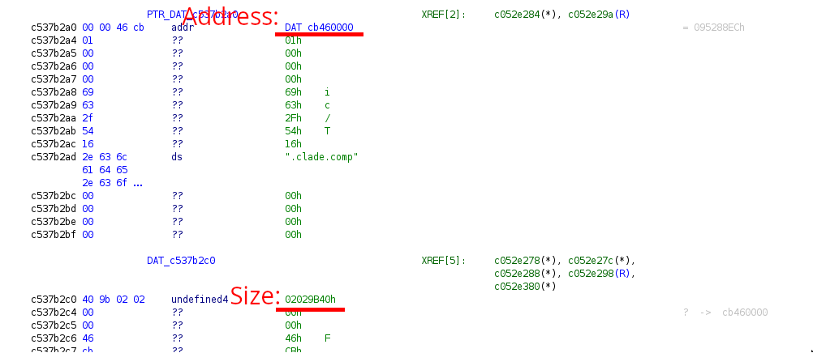
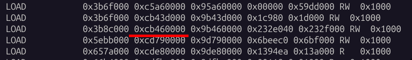

#  Decompressing sections

The Qualcomm baseband is shipped with a compressed section which is decompressed in hardware so QEMU wont be able to, resulting in a jump to an empty memory area which results in a crash.


## Extract and decompress

First step to decompression is to find the compressed data, you can look for ".clade.comp" in the ghidra strings and just above is a pointer to the compressed data which should correspond to a elf section:



```
readelf -l qdsp6sw.mbn 
```



Extract the section like this (this is the size of the section, not the size in ghidra):
```
dd skip=62808064 count=36642880 if=dsp6sw.mbn of=section bs=1
```

Then use [q6zip]() to decompress (here the size is the one in ghidra):
```
./cladetool -l 33725248 ../../clade_section >> dec_test.hex
```

## Load

To load the data execute the fuzzer (with fuzz=False) until it reaches a non-mapped area:

```
>  ./target/debug/hexagon_fuzz

[2025-10-08T10:55:51Z INFO  hexagon_fuzz::breakpoints] INTROSPECTED println | Fatal Error: Cause: 0xfe100044 Cause2: 0x5

[2025-10-08T10:55:52Z INFO  hexagon_fuzz::breakpoints] INTROSPECTED println | ELR: 0xbfea29f8, BADVA: 0xc5a4c198, SSR: 0xd816285c, SP:0x0
```

You can see here that it crashed at address ```0xd816285c``` so the start of the decompressed area is ```0xd8000000```

Now just add everything to the conf:

```
  "sections": [
    {
      "name" : "clade1",
      "type" : "clade",
      "file" : "../patching/dec_clade_section.hex",
      "format" : "hex",
      "address" : "0xd8000000"
    }
  ],

```
or
```
  "sections": [
    {
      "name" : "clade1",
      "type" : "clade",
      "file" : "../patching/dec_clade_section",
      "format" : "raw",
      "address" : "0xd8000000"
    }
  ],
```

this will be loaded everytime a ```HandleCladeLoading``` bp is triggered
